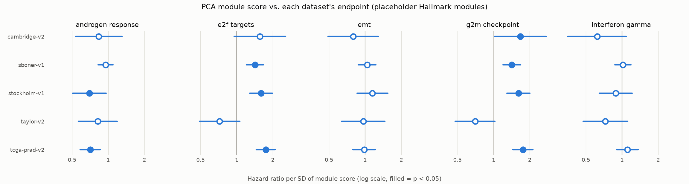

# PCA module scoring: first results

Built November 13, 2026 with `uv run --locked module-scores`. These are **placeholder modules**
(five MSigDB Hallmark sets, see [modules/README.md](../modules/README.md)) to show the method
works end to end. Swap in the CampLab modules when they are shared:

```bash
uv run --locked module-scores --modules path/to/camplab_modules.csv
```

## Method

For each dataset and module:

1. Match module genes to `genes.csv` `gene_symbol`. When several rows (probes) share a symbol, use
   the row with the highest mean expression, so genes with many probes don't dominate. Drop rows
   with no variance. The processed outputs are not changed.
2. Log-transform expression that is not log-scaled (max > 50). This currently applies only to
   Taylor, and is a placeholder until the team settles Taylor's scale.
3. Standardize each gene, then take PC1. The sign is set so that a higher score means higher
   module expression. Scores are scaled to SD 1 within the dataset.
4. Fit a Cox model on the dataset's own endpoint (eligible records only), giving a hazard ratio
   per SD of score, plus Harrell's C-index from the fitted model's risk predictions.
   This respects both harmful and protective associations. The C-index is measured on
   the fitting data; it is not a held-out performance estimate. Endpoints are not relabeled or pooled.

Outputs go to `data/analysis/module_scores/`: `<snapshot>_scores.csv` (sample × module),
`summary.csv`, `summary.md` and `hazard_ratios.png`.



## Results

The historical C-index column has been removed: it used a fixed score direction,
which reversed the fitted model ranking for protective modules. Rerun `module-scores`
to regenerate corrected C-indices. Hazard ratios, confidence intervals and p-values
are unaffected by this correction.

| Dataset | Endpoint (eligible, events) | Module | Genes used | PC1 variance | HR per SD (95% CI) | p |
|---|---|---|---:|---:|---|---:|
| tcga-prad-v2 | PFI (484, 91) | androgen_response | 97/101 | 17% | 0.71 (0.59–0.86) | 0.00039 |
| tcga-prad-v2 | PFI (484, 91) | e2f_targets | 186/200 | 30% | 1.75 (1.46–2.09) | 1.1e-09 |
| tcga-prad-v2 | PFI (484, 91) | emt | 194/200 | 35% | 0.98 (0.79–1.22) | 0.87 |
| tcga-prad-v2 | PFI (484, 91) | g2m_checkpoint | 183/200 | 28% | 1.75 (1.45–2.12) | 6.3e-09 |
| tcga-prad-v2 | PFI (484, 91) | interferon_gamma | 195/200 | 32% | 1.11 (0.90–1.36) | 0.34 |
| taylor-v2 | DFS (131, 27) | androgen_response | 101/101 | 33% | 0.82 (0.56–1.19) | 0.29 |
| taylor-v2 | DFS (131, 27) | e2f_targets | 199/200 | 37% | 0.72 (0.49–1.06) | 0.1 |
| taylor-v2 | DFS (131, 27) | emt | 200/200 | 30% | 0.97 (0.64–1.46) | 0.87 |
| taylor-v2 | DFS (131, 27) | g2m_checkpoint | 199/200 | 36% | 0.70 (0.48–1.03) | 0.068 |
| taylor-v2 | DFS (131, 27) | interferon_gamma | 200/200 | 27% | 0.73 (0.47–1.11) | 0.14 |
| cambridge-v2 | BCR (112, 19) | androgen_response | 96/101 | 20% | 0.83 (0.54–1.30) | 0.42 |
| cambridge-v2 | BCR (112, 19) | e2f_targets | 180/200 | 21% | 1.56 (0.96–2.55) | 0.076 |
| cambridge-v2 | BCR (112, 19) | emt | 194/200 | 26% | 0.80 (0.49–1.29) | 0.36 |
| cambridge-v2 | BCR (112, 19) | g2m_checkpoint | 177/200 | 19% | 1.67 (1.02–2.74) | 0.041 |
| cambridge-v2 | BCR (112, 19) | interferon_gamma | 191/200 | 21% | 0.62 (0.35–1.08) | 0.094 |
| stockholm-v1 | BCR (92, 45) | androgen_response | 96/101 | 14% | 0.70 (0.51–0.96) | 0.029 |
| stockholm-v1 | BCR (92, 45) | e2f_targets | 180/200 | 23% | 1.60 (1.28–1.99) | 3e-05 |
| stockholm-v1 | BCR (92, 45) | emt | 194/200 | 20% | 1.15 (0.86–1.54) | 0.35 |
| stockholm-v1 | BCR (92, 45) | g2m_checkpoint | 177/200 | 22% | 1.61 (1.29–2.01) | 2.2e-05 |
| stockholm-v1 | BCR (92, 45) | interferon_gamma | 191/200 | 25% | 0.89 (0.65–1.21) | 0.45 |
| sboner-v1 | PCSM (281, 165) | androgen_response | 72/101 | 14% | 0.95 (0.82–1.10) | 0.49 |
| sboner-v1 | PCSM (281, 165) | e2f_targets | 120/200 | 12% | 1.42 (1.21–1.67) | 2.7e-05 |
| sboner-v1 | PCSM (281, 165) | emt | 171/200 | 15% | 1.04 (0.88–1.23) | 0.66 |
| sboner-v1 | PCSM (281, 165) | g2m_checkpoint | 139/200 | 10% | 1.42 (1.20–1.68) | 5.6e-05 |
| sboner-v1 | PCSM (281, 165) | interferon_gamma | 142/200 | 9% | 1.02 (0.87–1.19) | 0.81 |

Sboner was built from William's `william_clavier` branch; Cambridge and Stockholm from `add-datasets`.
Sboner's endpoint columns don't follow the shared pattern yet, so its PCSM endpoint is read from
the shared `followup_months` and `survival_eligible` columns.

## Findings

- **The positive control works.** The proliferation modules (E2F targets, G2M checkpoint) predict
  worse outcome in TCGA (HR 1.75 per SD), Stockholm (1.60), Sboner (1.42) and Cambridge
  (1.56–1.67, borderline), as expected from the prostate cancer literature. This supports the
  scoring method.
- **Taylor is the exception, and it looks like a data problem.** Its proliferation scores trend the
  other way (HR about 0.7). Single proliferation genes in Taylor do rise with Gleason (MKI67
  ρ = 0.24, TOP2A ρ = 0.27), but the E2F PC1 score does not (ρ = −0.05). Instead it tracks each sample's
  overall intensity (ρ = 0.44 with the sample median), which is technical variation. In TCGA, PC1
  tracks Gleason (|ρ| = 0.45). Taylor's expression scale and normalization need to be settled
  before its module scores mean anything.
- Androgen response is associated with *lower* risk in TCGA and Stockholm (HR about 0.7). EMT and
  interferon-γ show no consistent association.
- PC1 explains 9–37% of module variance. That is lowest in Sboner, whose DASL panel also measures
  fewer module genes (72–171 per module), so Sboner scores are noisier.

## Open questions for the team

1. Should we use the CampLab module gene lists in this format (`gene,module`)?
2. How should Taylor be transformed or normalized before scoring?
3. Is "highest-mean probe per gene" acceptable, or do we want all probes, or the most variable one?
4. Should we use a single PC1 per module, or keep PC2 when PC1 explains little variance?
5. Should GSVA be run as the optional comparison?
