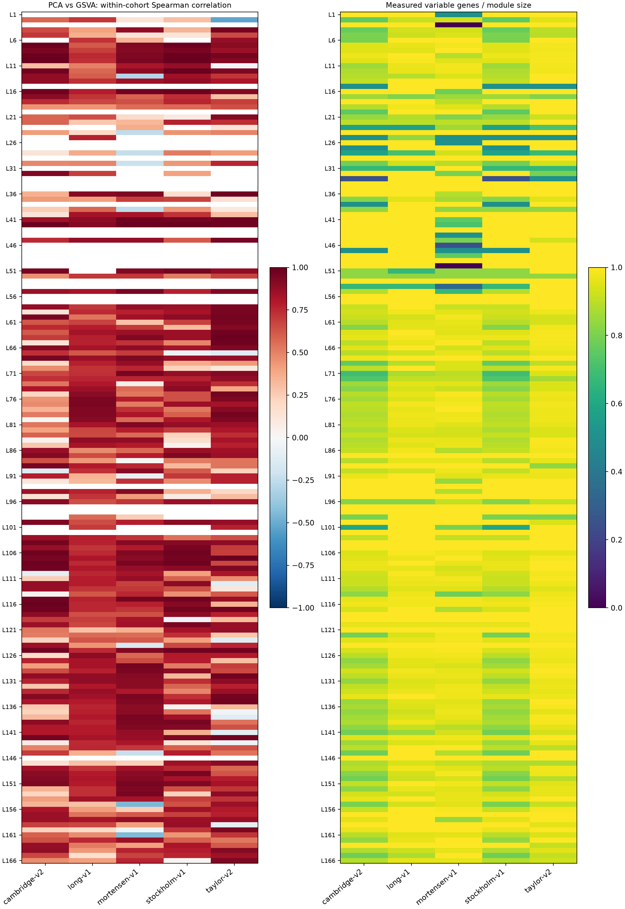
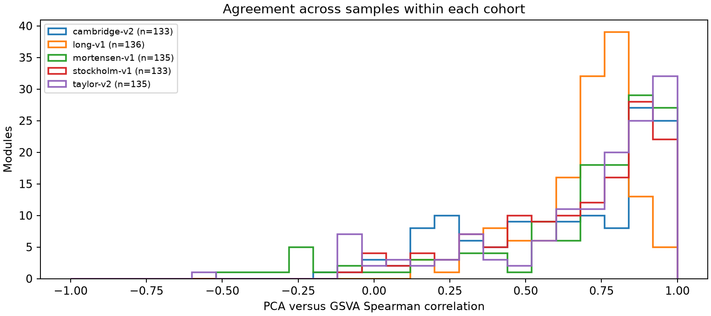

# PCA and GSVA: complete available cohorts

5 cohorts; 473 expression profiles; 166 source modules.

Scores are calculated separately within each cohort. No outcome associations, risk prediction, or pooling is performed.

| Cohort | Profiles | Modules with both scores | Median Spearman | Median gene coverage |
|---|---:|---:|---:|---:|
| cambridge-v2 | 112 | 133/166 | 0.709 | 90.8% |
| long-v1 | 100 | 136/166 | 0.744 | 98.0% |
| mortensen-v1 | 36 | 135/166 | 0.788 | 96.4% |
| stockholm-v1 | 94 | 133/166 | 0.753 | 90.8% |
| taylor-v2 | 131 | 135/166 | 0.787 | 98.4% |

## Interpretation and limits

- Positive correlation means the methods order patients similarly within that cohort; it is not prognostic validation.
- Modules with fewer than five measured variable genes are explicitly unscored, never filled with zero.
- PCA is standardized within cohort; GSVA scores depend on the measured background and cohort composition. Neither is a calibrated clinical risk score.
- Source gene symbols are matched exactly; no undocumented symbol alias mapping.
- L60 retains the original workbook annotation; the label questioned by the client remains unresolved.
- Complete structural exports establish computational eligibility, not uniform assay QC or independent biological validation.
- This run includes available complete exports only. It does not reproduce the meeting claim of eight cohorts / 1,486 tumors.

## Files

See module_comparison.csv for all module/cohort results, *_scores.csv for patient scores,
*_pca_loadings.csv.gz for PC1 gene weights, *_gene_coverage.csv.gz for missing genes, and analysis_manifest.json for hashes and settings.

## Findings from this run

Across five cohorts, 672 module/cohort pairs received both scores. Of those, 647
had positive and 25 had negative Spearman correlations. There are 131 modules with
both scores in all five cohorts. The cohort median agreement spans 0.709–0.788;
the methods are related but are not interchangeable for every module.

The cycling-kinase module L12 agrees strongly in Taylor, Cambridge, Stockholm and
Mortensen (rho 0.90–0.99), but less strongly in Long (0.58). L19 agreement is more
moderate (0.44–0.64). These describe method agreement, not outcome associations.
PC1 orientation is nonnegative throughout, but some modules correlate only weakly
with mean gene expression; inspect the orientation metric and loadings rather than
assuming that the sign rule guarantees coherent biology.

Patient scores, gene-level audits, loadings and full input/code provenance are in
`data/analysis/camplab-pca-gsva-final/`. The downloadable result bundle contains
those files and the source module table. The full expression matrices are not
included in the result bundle.

## Verification

- All five input snapshots passed independent CSV/H5AD checks, including annotations.
- Twenty-two score/loading/coverage/summary files reproduced byte-for-byte across runs.
- Working-tree and isolated-wheel test suites both passed 157 tests.
- Offline lock validation and wheel build passed.
- Existing output snapshots were preserved; results were verified before the implementation commit.

## Taylor preprocessing sensitivity

Independent review found that **six Taylor modules changed the sign of their
PCA–GSVA correlation under alternate preprocessing**. Taylor's legacy expression
transformation remains provisional. Interpret its module-level agreement, especially
correlation direction, as preprocessing-sensitive; reproducible tables under one
configuration do not establish robustness to another preprocessing choice. This
caveat does not change the reported primary-run tables.
